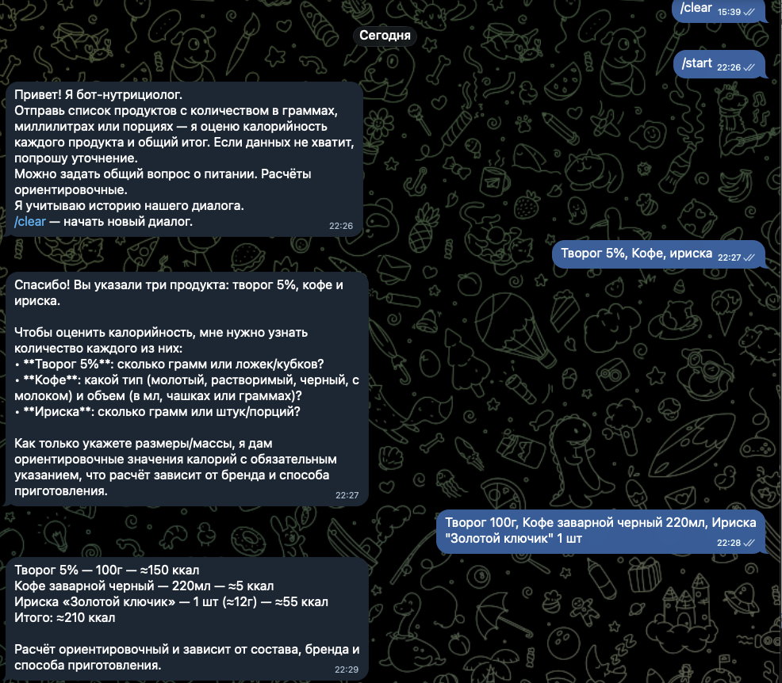

# llmstart-aidd-bot

Telegram-бот с ролью нутрициолога. Оценивает калорийность продуктов по текстовому списку и отвечает на общие вопросы о питании через OpenRouter.

## Основные возможности

- Оценивает калорийность каждого продукта и всего списка по массе, объёму или числу порций.
- Запрашивает недостающие количества и продолжает расчёт после уточнения.
- Отвечает на общие вопросы о питании с учётом контекста диалога.
- Хранит историю каждого пользователя в отдельном JSON-файле. При сохранении каталога данных она переживает перезапуск.
- Команда `/start` показывает инструкцию, а `/clear` очищает историю текущего пользователя.

## Расчёт калорийности

Отправьте список с количеством каждого продукта, например:

```text
Овсяные хлопья сухие — 80 г
Молоко 2,5% — 200 мл
Банан без кожуры — 100 г
```

Бот выводит каждый продукт отдельной строкой в формате `Продукт — количество — ≈ N ккал`, затем `Итого: ≈ N ккал`. Значения ориентировочные и зависят от состава, бренда и способа приготовления. Можно указать калорийность с упаковки.

Если количество или размер порции неясны, бот запросит уточнение и дождётся ответа перед общим итогом. Например, после «Гречка и курица» укажите массы и способ приготовления в следующем сообщении. Для штук и порций нужен понятный размер.

Бот даёт общую информацию о питании, не ставит диагнозы и не назначает лечение. По медицинским вопросам следует обратиться к врачу.

## Демонстрация



## Технологический стек

- Python 3.12, `uv` и `uv.lock` для установки зависимостей.
- `aiogram` 3 для получения сообщений Telegram через polling.
- Асинхронный клиент `openai` для запросов к OpenRouter и `python-dotenv` для локальной конфигурации.
- JSON-файлы для истории, Docker и Docker Compose для локального запуска, Railway для облачного деплоя из GitHub `main`.
- Make для команд проекта, Ruff и pytest для проверок.

## Установка и локальный запуск

Нужны Git, Make, [uv](https://docs.astral.sh/uv/) и Python 3.12. При отсутствии подходящего Python uv загрузит его при установке зависимостей.

1. Получите токен бота у Telegram BotFather и API-ключ OpenRouter. Выберите модель в OpenRouter.
2. Клонируйте репозиторий и создайте локальный файл настроек:

   ```sh
   git clone https://github.com/xkolbas/llmstart-aidd-bot.git
   cd llmstart-aidd-bot
   cp .env.example .env
   ```

3. Заполните `TELEGRAM_BOT_TOKEN`, `OPENROUTER_API_KEY` и `OPENROUTER_MODEL` в `.env`. Все три настройки обязательны. `HISTORY_MAX_EXCHANGES` по умолчанию равен `10` — сохраняются последние 20 сообщений пользователя и ассистента. Каждое новое сообщение сверх лимита вытесняет самое старое.
4. Проверьте роль нутрициолога в `prompts/system.txt`. Файл должен быть непустым.
5. Установите зависимости и запустите бота из корня проекта:

   ```sh
   make install
   make run
   ```

Откройте личный чат с ботом и отправьте `/start`. Бот должен ответить приветствием. Для остановки нажмите `Ctrl+C`. Одновременно запускайте только один экземпляр для одного токена.

Для проверки ответов LLM отправьте несколько текстовых вопросов и оцените соответствие ответов роли из `prompts/system.txt`. Модель выбирается настройкой `OPENROUTER_MODEL`. После изменения настроек или промпта перезапустите бота.

Для проверки истории сообщите боту факт и спросите о нём в следующем сообщении. `/start` сохраняет контекст; `/clear` очищает его, а перезапуск сохраняет. Истории пользователей разделены. Сообщения и команды одного пользователя обрабатываются по порядку, включая отправку ответов; разные пользователи могут общаться параллельно.

Общий таймаут запроса к LLM — 60 секунд, автоматические повторы отключены. По истечении таймаута ожидание прерывается. Ошибка или пустой ответ LLM не изменяют историю; бот сообщает о сбое и продолжает работу. Длинные ответы отправляются последовательно несколькими сообщениями. Неизвестные команды и нетекстовые сообщения получают подсказку.

При отсутствии обязательных настроек, некорректном лимите истории или недоступном/пустом промпте приложение завершается с понятной ошибкой. `.env` исключён из Git; не публикуйте секреты.

## Запуск в Docker

Нужны Make, Docker и Docker Compose. Подготовьте репозиторий и `.env` по шагам 1–4 локальной установки, затем выполните из корня проекта:

```sh
make docker-build
make docker-up
```

Бот запускается в фоне. Для просмотра логов и остановки используйте:

```sh
make docker-logs
make docker-down
```

Не запускайте локальный и контейнерный экземпляры одновременно с одним токеном Telegram. После изменения зависимостей или Docker-файлов повторите `make docker-build`; изменения Python-кода, тестов и системного промпта подключаются в контейнер из рабочей копии.

## История и облачный запуск

История хранится в `data/history/<user_id>.json`. `HISTORY_DIR` меняет каталог (относительный путь считается от корня проекта). Сохраняются последние `HISTORY_MAX_EXCHANGES` обменов. `/clear` удаляет файл пользователя. Повреждённый файл не перезаписывается автоматически.

В Docker `./data` подключается к `/app/data` и сохраняется после `make docker-down`. Каталог содержит диалоги и исключён из Git и Docker-образа.

В Railway подключите GitHub-репозиторий и ветку `main` к одному сервису. Укажите `TELEGRAM_BOT_TOKEN`, `OPENROUTER_API_KEY` и `OPENROUTER_MODEL` в Railway Variables, подключите постоянный том к `/app/data` и задайте `HISTORY_DIR=/app/data/history`. Сервис собирается из корневого `Dockerfile`. Запускайте один экземпляр на Telegram-токен, включая локальные запуски. Подробнее в разделе [«Облачный запуск в Railway»](docs/vision.md#10-облачный-запуск-в-railway).

## Проверки

```sh
make format
git diff
make lint
make test
```

Автоматические тесты не обращаются к Telegram или OpenRouter. Работа реального бота проверяется вручную отдельно.

Те же проверки в Docker:

```sh
make docker-format
git diff
make docker-lint
make docker-test
```

## Документы

- [Техническое видение](docs/vision.md)
- [Тасклист и прогресс](docs/tasklist.md)
- [Порядок работы](workflow.md)
