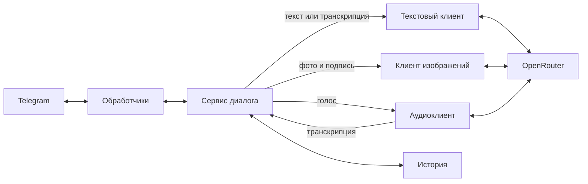

# Техническое видение проекта

## 1. Цель и границы MVP

Проект представляет собой персонального ИИ-нутрициолога в формате Telegram-бота. Роль, область знаний, стиль общения и медицинские ограничения определяются системным промптом.

Пользователь может задавать вопросы о питании текстом или голосом, отправлять фотографию еды либо содержимого холодильника. Бот анализирует рацион, оценивает калорийность, предлагает улучшения и составляет сбалансированный вариант питания из доступных продуктов. Перед персональной рекомендацией бот учитывает известные из диалога цели и ограничения пользователя, а при недостатке данных сначала задаёт уточняющие вопросы.

Текстовая версия нутрициолога поддерживает локальный и Docker-запуск, ограниченную файловую историю диалогов и облачный запуск одного экземпляра в Railway. Расширение добавляет анализ изображений и транскрипцию голосовых сообщений. История сохраняется после перезапуска и нового деплоя при подключённом постоянном хранилище.

В текущую версию не входят веб-интерфейс, административная панель, регистрация пользователей, несколько пользовательских ролей, обработка произвольных файлов, генерация изображений и аудиоответов, потоковая выдача ответа, аналитика, горизонтальное масштабирование, внешний справочник пищевой ценности, ведение дневника питания, постановка диагнозов и назначение лечения.

## 2. Технологический стек

- Python 3.12 — язык и версия среды выполнения.
- uv — управление зависимостями и запуск приложения. Зависимости описываются в `pyproject.toml`, зафиксированные версии хранятся в `uv.lock`.
- aiogram 3.x — работа с Telegram Bot API. Бот получает сообщения через polling.
- Официальный Python-клиент `openai` — асинхронные текстовые и мультимодальные запросы через OpenRouter с настройкой `base_url`.
- python-dotenv — загрузка переменных окружения из локального `.env`.
- pytest — автоматические тесты.
- Ruff — проверка и форматирование Python-кода.
- Docker и Docker Compose — локальный запуск приложения в контейнере.
- Makefile — единые команды для запуска и проверок с Docker и без него.
- Railway — облачный запуск одного persistent service из существующего `Dockerfile`.

В проекте не используются веб-фреймворк, ORM, база данных, DI-контейнер, миграции, Whisper и внешний API пищевой ценности. История диалогов хранится в JSON-файлах, а анализ питания выполняется LLM на основе данных пользователя.

Клиенты OpenRouter используют Chat Completions (`/api/v1/chat/completions`). Клиент изображений передаёт фото в `image_url` как base64 data URL. Аудиоклиент отправляет байты голосового сообщения в `input_audio.data` в base64 и указывает фактический формат в `input_audio.format`. Для голосовых в OGG/Opus используется модель и провайдер, принимающие `ogg` через Chat Completions. Модель по промпту возвращает текст транскрипции. [OpenRouter Audio](https://openrouter.ai/docs/guides/overview/multimodal/audio), [OpenRouter Multimodal API](https://openrouter.ai/blog/insights/every-modality-one-api/).

## 3. Архитектура приложения

Бот представляет собой одно асинхронное приложение со следующими компонентами:

- Telegram-обработчики принимают текст, скачивают фотографии и голосовые сообщения и отправляют текстовые ответы пользователю.
- Сервис диалога выбирает сценарий обработки, объединяет промпт, историю и новое сообщение и сохраняет результат.
- Текстовый LLM-клиент выполняет основной диалог с нутрициологом.
- Клиент изображений отвечает на запрос по фото еды или холодильника с учётом подписи, истории и правил нутрициолога. Промпт анализа фото дополняет основной системный промпт.
- Аудиоклиент получает аудио и промпт транскрипции. Сервис диалога передаёт полученный текст вместе с историей текстовому клиенту.
- Хранилище истории содержит отдельный JSON-файл для каждого пользователя.

Реализации всех трёх клиентов по умолчанию используют OpenRouter. Сервис диалога получает их через конструктор. Контракты клиентов принимают текст или медиа и возвращают текст. Это позволяет заменить реализацию, сохранив обработчики и логику диалога.



Точка входа загружает настройки и промпты, создаёт компоненты и запускает polling. Модель и промпт настраиваются отдельно для каждой задачи. Загрузка медиа из Telegram и запросы к OpenRouter выполняются асинхронно.

Приложение поддерживает только личные чаты с ботом. У каждого пользователя отдельная история диалога. Сообщения одного пользователя обрабатываются последовательно; сообщения разных пользователей могут обрабатываться параллельно.

В Railway приложение работает без входящего HTTP-сервера через Telegram polling. Запускается одна реплика, поскольку один Telegram-токен не должен одновременно использоваться несколькими poller-процессами.

## 4. Структура проекта

```text
src/bot/
    __init__.py
    main.py              # создание компонентов и запуск polling
    settings.py          # настройки из переменных окружения
    handlers.py          # Telegram-обработчики
    dialogue_service.py  # логика диалога
    llm_client.py        # текстовые запросы к OpenRouter
    image_client.py      # анализ изображений
    audio_client.py      # транскрипция аудио
    history_store.py     # файловая история
prompts/
    system.txt           # роль ИИ-нутрициолога
    image.txt            # промпт анализа фотографий
    audio.txt            # промпт транскрипции
tests/
docs/
.env.example
.gitignore
pyproject.toml
uv.lock
Dockerfile
compose.yaml
Makefile
README.md
```

Для MVP используется один пакет `bot` без дополнительных уровней каталогов. Каждый класс располагается в отдельном файле. Telegram-обработчики и точка входа могут быть обычными функциями.

## 5. Пользовательский сценарий

- `/start` — приветствие и краткая инструкция. Существующая история диалога сохраняется.
- Текстовое сообщение — запрос к LLM с системным промптом и историей пользователя, затем ответ в Telegram.
- Фотография еды — анализ блюда и оценка его состава или калорийности с явным указанием неопределённости.
- Фотография холодильника — распознавание доступных продуктов и предложение сбалансированного блюда или рациона с учётом целей пользователя.
- Голосовое сообщение — транскрипция через OpenRouter и дальнейшая обработка распознанного текста как обычного запроса.
- `/clear` — очистка истории пользователя и подтверждение начала нового диалога.
- Текстовый список продуктов с количеством — оценка калорийности каждого продукта и общего итога.
- Список имеющихся дома продуктов — предложение блюда или меню с учётом целей и ограничений пользователя. При нехватке данных бот сначала задаёт уточняющие вопросы.
- Продукт без достаточного количества — запрос массы, объёма или числа порций без итогового расчёта до уточнения.
- Общий вопрос о питании — краткий ответ в рамках компетенции нутрициолога.
- Медицински чувствительный вопрос — общая безопасная информация с рекомендацией обратиться к врачу; бот не ставит диагнозы и не назначает лечение.
- Неподдерживаемый файл или тип сообщения — подсказка о доступных форматах: текст, фотография и голосовое сообщение.
- Неизвестная команда — подсказка с доступными командами.
- Ошибка запроса к LLM — понятное сообщение пользователю. Неудачный обмен не добавляется в историю.
- Длинный ответ — отправка несколькими сообщениями с сохранением порядка.

Расчёт калорийности имеет следующий формат:

```text
Продукт — количество — ≈ N ккал
Продукт — количество — ≈ N ккал
Итого: ≈ N ккал
```

Каждый продукт выводится с новой строки. Бот явно указывает, что значения являются оценочными и могут зависеть от состава, бренда и способа приготовления. В расчёт входит только калорийность; обязательный расчёт БЖУ не предусмотрен.

## 6. История диалога

История хранится в отдельном JSON-файле для каждого Telegram `user_id`. Один обмен состоит из сообщения пользователя и ответа ассистента.

Лимит истории — 10 обменов, то есть 20 сообщений пользователя и ассистента суммарно. Лимит задаётся настройкой. История представляет собой очередь: при добавлении каждого нового сообщения сверх лимита удаляется одно самое старое сообщение. Удаление выполняется по сообщениям, а не по обменам целиком. После заполнения очереди в ней сохраняются последние 20 сообщений.

Текстовые запросы и запросы по фото передаются вместе с сохранённой историей и соответствующими промптами. Транскрипция выполняется отдельно от диалога. Системные промпты не входят в лимит истории. После успешного ответа сообщение пользователя и ответ ассистента последовательно добавляются в очередь. Неудачный запрос не изменяет историю.

История хранит только текст. Для голосового сообщения сохраняются транскрипция и ответ. Для фотографии сохраняются подпись или пометка «Фото» и ответ с результатом анализа.

Команда `/start` сохраняет историю. Команда `/clear` очищает её и выполняется последовательно с сообщениями пользователя, чтобы текущий запрос не восстановил очищенную историю. При перезапуске приложения история восстанавливается из файлов. До заполнения очереди, а также после очистки в ней может быть меньше 20 сообщений.

В MVP используется ограничение по числу сообщений без подсчёта токенов. Оно ограничивает объём истории, но не гарантирует попадания в контекст модели при очень длинных сообщениях.

## 7. Конфигурация

Успешный обмен сохраняется одной атомарной заменой JSON-файла через временный файл в том же каталоге. Файловые операции выполняются через `asyncio.to_thread()`. Ошибки чтения, записи и очистки сообщаются пользователю; повреждённый файл автоматически не перезаписывается. `/clear` удаляет файл пользователя.

Настройки приложения задаются переменными окружения:

- `TELEGRAM_BOT_TOKEN` — токен Telegram-бота, обязательная настройка.
- `OPENROUTER_API_KEY` — ключ OpenRouter, обязательная настройка.
- `OPENROUTER_MODEL` — модель основного диалога, обязательная настройка.
- `OPENROUTER_IMAGE_MODEL` — модель анализа изображений, обязательная настройка.
- `OPENROUTER_AUDIO_MODEL` — модель с поддержкой аудиовхода для транскрипции, обязательная настройка.
- `HISTORY_MAX_EXCHANGES` — лимит истории в обменах, по умолчанию `10`.
- `HISTORY_DIR` — каталог файлов `<user_id>.json`, по умолчанию `data/history` относительно корня проекта.

Промпты хранятся в `prompts/system.txt`, `prompts/image.txt` и `prompts/audio.txt` и загружаются при запуске приложения. Текстовый промпт задаёт роль нутрициолога и правила персональных рекомендаций; специализированные промпты ограничивают задачи анализа изображения и транскрипции.

Локальные настройки хранятся в `.env`. Файл `.env.example` содержит пример конфигурации без секретов. Файл `.env` исключён из Git.

В Railway те же настройки создаются как service variables. Секретные значения не добавляются в репозиторий, `Dockerfile`, промпты или логи.

При отсутствии обязательных настроек или пустом обязательном промпте приложение завершается с понятной ошибкой.

## 8. Обработка ошибок и логирование

Таймаут каждого запроса к OpenRouter — 60 секунд. При ошибке текстового или мультимодального клиента либо пустом ответе бот сообщает пользователю: «Не удалось получить ответ. Попробуйте ещё раз».

Неудачный запрос не изменяет историю и не останавливает обработку следующих сообщений. В MVP автоматические повторы запросов к LLM отключены; пользователь повторяет запрос самостоятельно.

Ошибка отправки ответа в Telegram записывается в лог. Уже сохранённый успешный ответ LLM остаётся в истории.

Логи выводятся в консоль и содержат события запуска, остановки и ошибки с техническими подробностями. Токены, API-ключи, промпты, содержимое диалогов и исходные медиа в логи не записываются.

## 9. Локальный и Docker-запуск

Перед первым запуском пользователь копирует `.env.example` в `.env`, заполняет настройки и проверяет промпты для трёх сценариев.

| Действие | Без Docker | С Docker |
|---|---|---|
| Установка зависимостей / сборка | `make install` | `make docker-build` |
| Запуск бота | `make run` | `make docker-up` |
| Тесты | `make test` | `make docker-test` |
| Проверка кода | `make lint` | `make docker-lint` |
| Форматирование кода | `make format` | `make docker-format` |
| Остановка | `Ctrl+C` | `make docker-down` |
| Просмотр логов | В текущем терминале | `make docker-logs` |

Проверка кода выполняется Ruff без изменения файлов. Форматирование выполняется Ruff и автоматически приводит код к единому оформлению. Обычный порядок проверок после изменений: `make format` → просмотр diff → `make lint` → `make test`.

Оба способа запуска используют `uv.lock`. Для одного токена бота одновременно запускается только один экземпляр приложения. Инструкция по настройке, запуску и проверкам размещается в `README.md`.

## 10. Облачный запуск в Railway

Railway используется как persistent service для постоянно работающего Telegram polling-процесса. Сервис подключается к GitHub-репозиторию и ветке `main`. При каждом push Railway автоматически создаёт новый деплой и использует найденный в корне `Dockerfile`. Команда запуска берётся из `CMD` образа и отдельно не переопределяется.

В Railway Variables задаются `TELEGRAM_BOT_TOKEN`, `OPENROUTER_API_KEY`, модели для текста, изображений и аудио, а также `HISTORY_MAX_EXCHANGES`. Используется одна реплика. Публичный домен, переменная `PORT` и HTTP-healthcheck не настраиваются, поскольку бот не принимает входящие HTTP-запросы.

Restart policy — `On Failure`. После деплоя проверяются успешная сборка, статус `Active`, сообщения запуска в логах и реальные сценарии с текстом, фотографией и голосом в Telegram. Логи не должны содержать секреты, промпты, содержимое диалогов и исходные медиа.

Источники требований Railway: [Services](https://docs.railway.com/services), [Start Command](https://docs.railway.com/deployments/start-command), [Restart Policy](https://docs.railway.com/deployments/restart-policy).

## 11. Тестирование

Для постоянной истории в Railway подключается Volume к `/app/data`, а `HISTORY_DIR` задаётся как `/app/data/history`. В Docker Compose используется постоянный каталог `./data`. Файлы диалогов исключены из Git и Docker-образа.

Автоматические тесты выполняются на `pytest` без реальных запросов к Telegram и OpenRouter. Внешние сервисы заменяются тестовыми заглушками.

Проверяются следующие сценарии:

- Раздельная история пользователей, лимит 20 сообщений и вытеснение самого старого сообщения.
- Очистка истории через `/clear`.
- Передача системного промпта, истории и текущего сообщения в LLM.
- Маршрутизация текста, фотографии и голосового сообщения в соответствующий клиент.
- Передача фото как base64 data URL в `image_url` с моделью для фотографий, основным промптом и дополнением для фото.
- Передача аудио в base64 через `input_audio` с указанием формата, получение транскрипции и её дальнейшая обработка как текста.
- Раздельная конфигурация моделей и промптов; возможность подменить клиенты тестовыми реализациями.
- Отсутствие исходных медиа и base64-данных в истории и логах.
- Сохранение успешного обмена; неизменность истории при ошибке или пустом ответе.
- Последовательная обработка сообщений и `/clear` одного пользователя.
- Разбиение длинного ответа с сохранением текста и порядка.
- Проверка обязательных настроек при запуске.
- Наличие в системном промпте правил роли нутрициолога, формата расчёта, уточнения количества и медицинских ограничений.
- Соответствие приветствия и пользовательской инструкции новой роли.

Ручная проверка с реальными сервисами включает запуск без Docker и в Docker, `/start`, диалог с учётом контекста, `/clear` и сохранение истории после перезапуска. Для роли нутрициолога дополнительно проверяются списки продуктов, уточнение целей и недостающих данных, фотографии еды и холодильника, голосовой запрос, общий вопрос о питании и медицински чувствительный запрос.

Облачная проверка включает сборку и запуск в Railway, статус `Active`, отсутствие секретов, диалогов и медиа в логах, реальные сценарии с текстом, фотографией и голосом в Telegram и автоматический деплой нового коммита из `main`.

Автоматические тесты проверяют логику приложения. Ручная проверка подтверждает работу интеграций с Telegram и OpenRouter.

## 12. Критерии готовности

Расширенная версия готова, когда выполнены следующие условия:

- Бот запускается по инструкции в `README.md` без Docker и в Docker.
- Бот отвечает на текстовые сообщения через OpenRouter с заданным системным промптом и историей пользователя.
- Истории пользователей разделены; сохраняются последние 20 сообщений.
- `/start`, `/clear`, неизвестные команды, текст, фотографии и голосовые сообщения обрабатываются по согласованным правилам.
- Длинные ответы отправляются полностью и по порядку.
- Ошибки LLM не изменяют историю и не мешают последующим запросам.
- Перезапуск сохраняет историю; секреты, содержимое диалогов и исходные медиа не попадают в логи.
- Проверки Ruff и автоматические тесты проходят.
- Ручные проверки из раздела 11 выполнены; их результаты зафиксированы.
- Бот отвечает в роли нутрициолога и соблюдает медицинские ограничения роли.
- Перед персональной рекомендацией бот использует известные цели пользователя или запрашивает недостающие данные.
- Фотография еды или холодильника анализируется отдельным клиентом с собственной моделью и промптом; неопределённость результата явно обозначается.
- Голосовое сообщение транскрибируется нативно через OpenRouter с `input_audio`, без Whisper, после чего обрабатывается как текст.
- Текстовый клиент, клиент изображений и аудиоклиент можно заменить без изменения обработчиков и сервиса диалога.
- Список с достаточными количествами возвращается построчно с оценкой ккал для каждого продукта и общим итогом.
- При недостатке количества бот запрашивает уточнение и не выдаёт итог преждевременно.
- Пользователь видит, что расчёт калорийности является оценочным.
- Один экземпляр бота постоянно работает в Railway из ветки `main` и автоматически обновляется после push.
- Railway использует обязательные variables, одну реплику и restart policy `On Failure`; реальная работа подтверждена через Telegram и логи.

Соответствие ответов заданной роли оценивается вручную на нескольких примерах диалога.

## 13. Порядок реализации

1. Основа проекта: зависимости, структура пакета, настройки, системный промпт, Ruff и pytest.
2. Логика диалога: история, клиент OpenRouter, сервис диалога и тесты.
3. Telegram: обработчики сообщений и команд, последовательная обработка, длинные ответы, ошибки и логирование.
4. Запуск: Docker, Docker Compose, Makefile и инструкция в `README.md`.
5. Проверка MVP: автоматические тесты, ручные проверки обоих способов запуска и фиксация результатов.
6. Адаптация роли: системный промпт, приветствие, пользовательская инструкция, уточнение целей, проверки рекомендаций и границ роли.
7. Облачный запуск: Railway Variables, одна реплика, GitHub autodeploy, проверка логов и текстового сценария в Telegram.
8. Изображения: отдельный клиент, модель и промпт, обработка фотографий еды и холодильника.
9. Аудио: отдельный клиент, модель и промпт, транскрипция через `input_audio` и передача результата в диалог. После обновления Railway проверяются фото и голос в Telegram.

Каждый этап завершается проверкой результата и согласованием перед переходом к следующему.
